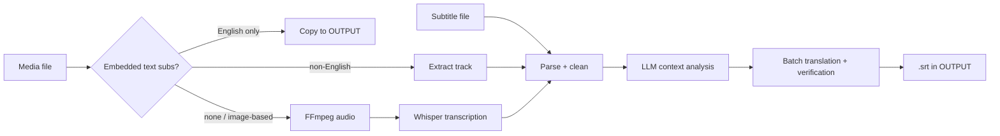

# SubTranslate

**Offline English subtitles for anime (and other foreign-language video), generated entirely on your own machine.**

SubTranslate pulls subtitles out of video files, or transcribes the audio with [OpenAI Whisper](https://github.com/openai/whisper). It then translates the dialogue to natural English with a local LLM running in [Ollama](https://ollama.com). The output is standard SubRip (`.srt`) files that work in any video player.

- 🔒 **100% local.** No cloud APIs and no accounts. Your media never leaves your machine.
- 🎌 **Built for anime.** Reads the whole episode first, then keeps character voices, honorifics, and terminology consistent.
- 🧠 **Context-aware translation.** Each batch also sees the lines before and after it, so sentences split across cues still read correctly.
- 🛡️ **Self-checking.** Missing, untranslated, or runaway lines are detected and re-translated automatically.
- ⚡ **GPU accelerated.** Supports AMD (ROCm), NVIDIA (CUDA), or plain CPU.

---

## Table of Contents

1. [Requirements](#requirements)
2. [Installation](#installation)
3. [Usage](#usage)
4. [Command-Line Options](#command-line-options)
5. [Supported Formats](#supported-formats)
6. [How It Works](#how-it-works)
7. [Custom Glossary / Context](#custom-glossary--context)
8. [Configuration](#configuration)
9. [Troubleshooting](#troubleshooting)
10. [License](#license)

---

## Requirements

| Component | Requirement |
|:---|:---|
| **OS** | Linux (macOS / WSL should work in CPU or CUDA mode) |
| **Python** | 3.10 or newer |
| **FFmpeg** | `ffmpeg` and `ffprobe` available in `PATH` |
| **Ollama** | Installed and running, with a translation model (default: `qwen2.5:14b`) |
| **Hardware** | AMD GPU with ROCm, NVIDIA GPU with CUDA, or a multi-core CPU |

Rough VRAM guide: Whisper `large-v3` needs ~10 GB and `qwen2.5:14b` needs ~9 GB. The two never run at the same time, because SubTranslate unloads one before loading the other.

## Installation

```bash
git clone https://github.com/<your-username>/SubTranslate.git
cd SubTranslate
bash setup.sh
```

`setup.sh` will:

1. Check for Python 3.10+ and FFmpeg.
2. Create a virtual environment in `venv/`.
3. Auto-detect your GPU and install the right PyTorch build (ROCm, CUDA, or CPU).
4. Install the dependencies from [`requirements.txt`](requirements.txt).
5. Pre-download the Whisper `large-v3` model (~3 GB).
6. Pull the default Ollama model (`qwen2.5:14b`) if it is missing.

You can override the defaults with environment variables:

```bash
TORCH_BACKEND=cuda bash setup.sh          # force rocm | cuda | cpu
WHISPER_MODEL=medium bash setup.sh        # pre-download a different Whisper model ("none" to skip)
OLLAMA_MODEL=qwen2.5:7b bash setup.sh     # pull a different translation model
```

## Usage

### Process everything in `INPUT/`

```bash
cp /path/to/episode01.mkv INPUT/
./run.sh
```

Finished subtitles appear in `OUTPUT/`.

### Process a single file

```bash
./run.sh episode01.mkv                    # looks in INPUT/ first
./run.sh /any/path/episode01.mkv          # or give a full path
./run.sh episode01.mkv --ignore-subs      # extra flags are passed through
```

### Output file naming

| Input | Output |
|:---|:---|
| `episode01.mkv` | `OUTPUT/episode01.srt`: English subtitles |
| | `OUTPUT/episode01.original.srt`: original-language transcript |
| `video.ja.srt` | `OUTPUT/video.ja.en.srt`: English subtitles |

## Command-Line Options

All options work with both `./run.sh` and `python subtranslate.py`.

| Option | Description | Default |
|:---|:---|:---|
| `-f`, `--file <path>` | Process a specific file or directory | `INPUT/` |
| `-o`, `--output-dir <path>` | Where to write subtitles | `OUTPUT/` |
| `-w`, `--whisper-model <name>` | Whisper model (`tiny`, `base`, `small`, `medium`, `large-v3`, `turbo`) | `large-v3` |
| `-m`, `--ollama-model <name>` | Ollama translation model | `qwen2.5:14b` |
| `-b`, `--batch-size <n>` | Subtitle lines per translation request | `20` |
| `-l`, `--language <code>` | Force the source language (`ja`, `ko`, `zh`, …) | auto-detect |
| `-i`, `--ignore-subs` | Ignore embedded subtitle tracks and always use Whisper | off |
| `--transcribe-only` | Only transcribe media files, skip translation | off |
| `--translate-only` | Only translate subtitle files, skip media files | off |
| `--version` | Print the version and exit | |

Examples:

```bash
./run.sh --whisper-model medium           # faster, less VRAM
./run.sh --ollama-model aya-expanse:8b    # alternate translation model
./run.sh --language ja                    # skip language auto-detection
./run.sh video.mp4 --transcribe-only      # original-language subtitles only
```

## Supported Formats

**Media** (subtitle extraction or Whisper transcription, then translation):
`.mp4` `.mkv` `.webm` `.avi` `.mov` `.flv` `.m4v` `.ts` `.wmv`

**Subtitles** (translation only):
`.srt` (SubRip), `.ass` / `.ssa` (SubStation Alpha), `.vtt` (WebVTT)

Subtitle files in UTF-8, UTF-16, Shift-JIS, GBK, and other legacy encodings are detected automatically.

## How It Works



### Phase 1: Extraction and transcription

1. **Subtitle track detection.** Embedded text tracks are inspected with `ffprobe`. Full-dialogue tracks are preferred over *Signs & Songs* or forced tracks, and Japanese is preferred over other languages. Image-based tracks (PGS/VobSub) are skipped.
2. **Audio extraction.** If there is no usable track, FFmpeg extracts 16 kHz mono audio.
3. **Whisper transcription.** Whisper is loaded into GPU memory once for all files. If VRAM runs out, it falls back to a smaller model automatically.
4. **Cleanup.** Formatting tags, ASS vector drawings, duplicate layers, micro-duration cues, repetition loops, and common Whisper hallucinations (e.g. *"ご視聴ありがとうございました"*) are removed.
5. **Memory release.** Whisper is unloaded from the GPU to make room for the LLM.

### Phase 2: Context analysis and translation

1. **Language detection.** The source language is detected from the script itself (kana → Japanese, hangul → Korean, hanzi → Chinese). This is more reliable than container tags, which are often missing or wrong.
2. **Context and glossary analysis.** The LLM reads dialogue samples from the start, middle, and end of the episode. It builds a briefing with character profiles, tone guidelines, and a terminology glossary. Your own glossary takes priority.
3. **Bidirectional context translation.** Lines are translated in numbered batches. Each batch includes the previous translated lines and a preview of the upcoming lines.
4. **Verification and retry.** Lines that come back empty, still contain CJK characters, or are suspiciously long get re-translated: first as a group with the surrounding passage, then one at a time. Failed Ollama requests are retried with backoff.
5. **Subtitle generation.** Timed `.srt` files are written to `OUTPUT/`. The original-language transcript is saved *before* translation starts, so a translation failure never loses it.

## Custom Glossary / Context

Give the translator character names and terms so it spells them consistently. Glossary entries take priority over the LLM's own analysis.

| File | Scope |
|:---|:---|
| `INPUT/context.txt`, `INPUT/glossary.txt` / `.json` (or the same names in the project root) | All files |
| `<video-name>.context.txt` next to the media/subtitle file | That file only (combined with the global file) |

Example (see [`glossary.example.txt`](glossary.example.txt)):

```text
Show: Shangri-La Frontier
Characters:
- Sunraku (Rakuro Hizutome)
- Saiga-0 (Rei Saiga)
Terms:
- Shanfro: Shangri-La Frontier
- Kusoge: trash game
```

## Configuration

Advanced defaults live at the top of [`subtranslate.py`](subtranslate.py):

| Parameter | Default | Purpose |
|:---|:---|:---|
| `DEFAULT_WHISPER_MODEL` | `"large-v3"` | Whisper speech recognition model |
| `DEFAULT_OLLAMA_MODEL` | `"qwen2.5:14b"` | Ollama translation model |
| `TRANSLATION_BATCH_SIZE` | `20` | Subtitle lines per translation request |
| `LOOKBACK_COUNT` | `5` | Previous translated lines included for continuity |
| `LOOKAHEAD_COUNT` | `3` | Upcoming lines previewed for sentence flow |
| `MIN_CUE_DURATION_MS` | `100` | Cues shorter than this are treated as artifacts |
| `OLLAMA_RETRIES` | `2` | Extra attempts for failed Ollama requests |

## Troubleshooting

<details>
<summary><b>AMD GPU is not detected</b></summary>

1. Check that ROCm sees your GPU: `rocminfo | grep gfx`
2. `run.sh` sets `HSA_OVERRIDE_GFX_VERSION` automatically for RDNA2 (`10.3.0`) and RDNA3 (`11.0.0`) cards. For other cards, export the right value yourself before running. A value you set always takes priority:
   ```bash
   export HSA_OVERRIDE_GFX_VERSION=10.3.0
   ```
3. Make sure the ROCm build of PyTorch is installed: `TORCH_BACKEND=rocm bash setup.sh`
</details>

<details>
<summary><b>Out-of-memory (OOM) errors during transcription</b></summary>

SubTranslate already unloads Ollama models and falls back to smaller Whisper models automatically. If it still fails:

```bash
./run.sh --whisper-model medium     # or: turbo, small
```
</details>

<details>
<summary><b>"Cannot reach Ollama" / "model is not installed"</b></summary>

```bash
ollama serve                 # start the service (if not running as a system service)
ollama pull qwen2.5:14b      # install the model
```

If Ollama isn't available, the original-language `.srt` files are still written.
</details>

<details>
<summary><b>Untranslated lines or misaligned subtitles</b></summary>

- Lines that still can't be translated after all retries keep their original text, and a count is printed at the end.
- Try a smaller batch size: `./run.sh --batch-size 10`
- Add character names and terms to a [glossary](#custom-glossary--context).
- Try a larger or different model, e.g. `--ollama-model qwen2.5:32b`.
</details>

<details>
<summary><b>Wrong source language detected</b></summary>

Force it explicitly: `./run.sh --language ja`. This affects both Whisper and the translator.
</details>

## License

Released under the [MIT License](LICENSE). You are free to use, modify, and integrate SubTranslate in other projects, as long as the copyright notice is kept.
